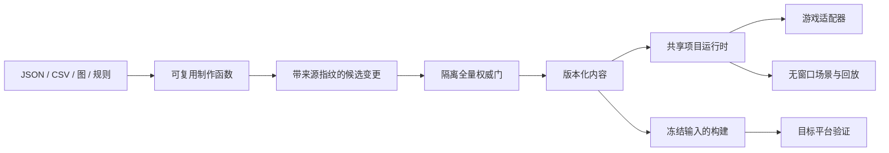

# RPG 开发工具套件补全方案

状态：**补全设计，按工作包验收**。本文中的接口是目标契约，不代表全部已实现。工作区已有共享状态、事件执行器和对话模块的初步实现；在完成注册、游戏接入及整体验收前，仍不能视为对应工作包已交付。当前可用能力以使用指南和可复现验收证据为准。

依据：[主流引擎工作流对照](14-engine-comparison.md)、[现有架构与验收记录](12-toolkit-design.md)、[现有使用指南](13-toolkit-usage.md)。本方案以等距、单机、内容驱动的2D RPG为目标，不以复制商业引擎全部功能或统一IDE为验收条件。

## 1. 补全目标与现状

交付一套能独立组合的工具，支持从数据库与地图制作，到剧情、任务、完整世界状态、真实游戏调试和可核验发布的完整流程。人、脚本、AI和现有五个编辑器使用同一份内容、同一个运行时、同一套权威门。

目前已有92项测试通过的工具基础，包括内容契约、候选变更、图引用、地图笔刷、CSV交换、库存迁移、战斗回放、资源处理和发布预检。这是既有验收记录，不是本方案新增能力的测试成绩。

直接检查 `main.nut` 后，优先处理以下实际差距：

| 事实 | 对制作流程的影响 | 设计决策 |
|---|---|---|
| `runSteps()` 同步遍历，wait不等待，parallel顺序执行 | 文档能通过，不代表演出按设计发生 | 先建立共享可暂停事件运行时 |
| dialogue/message显示reference，play_animation没有播放器 | 图编译与图片导入尚未形成真实剧情体验 | 对话会话及表现适配必须接入游戏 |
| matchingEvent返回首个匹配项，触发覆盖有限 | 多事件、重复触发和任务推进缺少明确规则 | 建立确定性调度、完成状态和重入策略 |
| 存档工具仅覆盖库存v1 | 地图、世界变量、任务和剧情进度不能整体恢复 | 定义世界状态与版本化恢复流程 |
| 包检查针对文件，不证明目标系统能运行 | 有启动器不等于已验证平台发布 | 把源码快照、检查结果、目标机证据绑定到同一构建 |

## 2. 能力范围与对标方式

| 能力包 | 对标的工作流 | 本方案交付 | 首版不包括 |
|---|---|---|---|
| 事件/对话/任务 | RPG Maker事件与消息选择 | 可暂停演出、条件选项、任务目标和奖励、真实游戏适配 | 任意脚本节点、联网协作任务 |
| 世界存档 | RPG存档槽与读档流程 | 世界完整状态、校验恢复、显式迁移、损坏恢复 | 云同步；首版战斗中途保存 |
| 地图生产 | 自动地形、房间制作 | 八邻域连接、双地形过渡、对象复用、预览与可达性检查 | 任意投影、任意Tiled格式导入 |
| 内容复用 | Godot Scene / Unity Prefab工作流 | 模板、变体、实例化、来源与覆盖冲突报告 | 通用场景树继承、运行时ECS重构 |
| 动画/媒体 | Sprite与动画状态/导入流程 | 剪辑预览、简单状态图、完整解码、确定性图集和转码适配 | 3D骨骼、动画混合树、完整非线性剪辑器 |
| 本地化 | Translation/Localization资源 | 稳定文本键、占位符校验、fallback、运行时语言切换 | 完整ICU表达式语言和任意脚本插值 |
| 调试/性能 | Debugger/Profiler与测试 | 世界命令回放、断点/单步、追踪、真实计时 | 替代引擎原生CPU/GPU Profiler |
| 平台交付 | Export/Build Profiles | 封装一致性、依赖扫描、三平台烟测与签名挂接 | 移动/主机/Web交叉编译；自动获得签名凭据 |

## 3. 统一架构与兼容原则

### 3.1 三个边界

- **内容制作层（Python）**：图编译、模板展开、媒体导入、迁移计划、候选文件与构建编排。不重新实现条件、战斗、奖励等游戏规则。
- **项目运行时层（Squirrel）**：世界状态、条件求值、命令应用、事件调度、对话/任务、存档快照与回放。同一模块被游戏和无窗口宿主导入。
- **表现与平台适配层**：地图载入、镜头、精灵、音频、输入、UI、存档文件系统和目标平台运行。通过能力描述与结果确认接入。

主循环驱动共享运行时；CLI无窗口场景也驱动它。`main.nut` 最终只保留输入和表现适配，不再拥有另一份条件求值/奖励逻辑。测试替身只替换表现端点，不替换业务规则。



### 3.2 契约变更

新内容类型拟采用 `eve.rpgc.dialogue`、`eve.rpgc.quest`、`eve.rpgc.locale`、`eve.rpgc.animation-state`。名称在实现前的schema评审中固定；每个kind必须同时交付schema、语义门、references、workflow注册、加载器、消费端、示例及负例。没有消费端不得标记完成。

template、terrain、import recipe和build profile属于制作元数据，首版保持独立sidecar，不为了CLI便利全部塞入运行时workflow。它们编译成现有内容或明确注册的新kind，保留来源映射。

现有event/condition v1默认不变。新增步骤或字段需要新schema版本及明确转换器，禁止在旧schema中静默放宽未知字段检查。v1事件首次可以沿用路径定位，编辑结构后仅能从安全点恢复；新版本事件使用稳定step ID，跨版本会话恢复必须有映射，否则拒绝续接。

### 3.3 诊断与能力

所有新工具继续使用 `ok/diagnostics`，诊断含code、severity、文档路径与JSON Pointer；能力报告另含supported、reason、SDK版本和验证fixture版本。未运行、能力不足、检查失败不得合并成PASS。

SDK能力探测必须运行最小操作并确认结果，不能仅以函数名存在判定支持。优先做项目适配；确需C++改动时按 `ENGINE.md` 在EVEngine独立提交，目标为dev，项目只提高必要的min SDK或提供显式降级。

## 4. P0：事件运行时、对话与世界状态

### 4.1 共享世界状态和命令

拟新增 `lib/rpgc_world_state.nut`，集中管理地图与位置、玩家朝向、队伍、库存装备、世界变量、开关、消耗对象、任务、已完成事件、逻辑时刻及各随机流。内容定义继续存放在内容树；状态只保存定义ID和变化量，不复制整份数据库。

拟议纯计算接口：

```text
WorldState.validate(snapshot, contentIndex) -> Result
WorldState.apply(state, command) -> Result{state, domainEvents}
Conditions.evaluate(condition, state, context) -> Result<bool>
```

命令有明确kind、commandId、逻辑序号和参数。物品/战斗操作调用既有 `RpgcItems` / `RpgcBattle`，不写第二份公式。先生成候选状态并完成检查，再整体提交当前命令的纯状态变化。外部表现效果使用确认协议，不宣称可以回滚已播放音频或已提交平台I/O。

逻辑计数和ID必须位于SDK可精确表示的范围；超界、NaN、非法枚举拒绝，不做静默截断。持续集成保留库存精度损失反例。

### 4.2 可暂停事件调度

拟新增 `lib/rpgc_event_runner.nut`，迁移现有 `runSteps/conditionHolds/applyVariable` 职责。

```text
EventRunner.enqueue(trigger, context) -> Result<ticket>
EventRunner.tick(state, logicalDelta, acknowledgements) -> Result{requests, domainEvents}
EventRunner.status(ticket) -> queued | running | waiting | completed | failed | cancelled
EventRunner.checkpoint() -> Result<serializableCursor>
```

- wait消耗显式逻辑时间，不读取墙钟；parallel创建子任务并等待全部完成，错误取消其余未提交动作。
- dialogue、地图切换、镜头和动画发出带operationId的表现请求，收到匹配确认才推进。迟到/重复确认被忽略并记录，不重复执行状态命令。
- 触发器按priority降序、事件ID升序确定队列顺序。一次分发使用入队时的候选快照，新产生的触发排到后续逻辑步，防止单次分发跨完全部任务阶段。
- `repeatable:false` 仅在完整完成后标记；运行中的同事件重复触发合并。失败是否重试由调用方明确决定，不自动重复奖励。
- 每tick设置最大步骤预算；无等待循环、级联触发超限返回诊断并暂停，不挂住主线程。
- 显式地图转移命令在加载确认后更新位置，再产生map_entered；portal、game_started、object_interacted、quest_completed和manual都经过同一路径。
- 缺能力时返回 `runtime.capability-missing`；不能把未播放的动画或未实现的时刻条件当作成功。

首轮交付先覆盖现有步骤的真实语义。复杂运动与音频若SDK尚无可用端点，要在验收报告中列为未完成，不能继续保留静默no-op。

### 4.3 对话与本地化基础

拟新增 `lib/rpgc_dialogue.nut`、`dialogue.py` 和 `locale.py`。对话文档包括稳定node/option ID、speaker ID、textKey、条件、结果命令和next；节点类型首版为line、choice、command、end。支持对话循环，但连续无等待跳转受预算约束。

```text
Dialogue.start(dialogueId, state) -> Result<session>
Dialogue.view(session) -> {speaker, textKey, visibleOptions, revision}
Dialogue.choose(session, optionId, expectedRevision) -> Result
Dialogue.advance(session, expectedRevision) -> Result
```

选项展示和提交都检查条件；状态变化后旧revision拒绝提交并刷新，隐藏选项不能通过CLI绕过。选择结果通过统一命令应用，先检查完整结果批次，再提交纯状态变化。对话ID命名空间与message文本键明确分开。

文本使用稳定键，不再以数组pointer作为运行时身份。现有pointer提取工具保留用于迁移，产出键映射候选。首版只允许命名占位符，例如 `{playerName}`；语言间占位符集合必须一致，不执行表达式。fallback顺序固定为请求语言→项目默认语言→诊断占位文本；测试严格模式缺键失败。

表现只需一个最小对话适配器和独立预览入口，不制作统一IDE。取消不会执行尚未选择的结果；已提交结果不回滚，取消规则进入会话文档。

### 4.4 任务运行时与现有编译器迁移

拟新增 `lib/rpgc_quests.nut`。任务定义包含稳定目标ID、依赖、计数条件、奖励与状态转移。任务状态为inactive/active/completed/claimed/failed，完成与领取区分，领奖重复请求不重复发放。

计数只消费统一domainEvents，按事件序号去重；库存不足、背包容量不足等结果由现有物品运行时判断，不能先标记claimed再丢奖励。任务完成事件由成功状态提交产生。

现有 `quest-plan` 仍可编译成event；新增任务定义必须显式迁移其 `quest.<id>.stage`，避免两套进度同时成为权威。`quest.bounty` 等外部引擎注册问题先确定是否有实际消费者：项目任务和引擎QuestDefinition之间设桥接器，缺注册时保留诊断，不能通过删除检查或虚构任务消除warning。

### P0完成标准

同一场景在真实游戏和无窗口宿主使用同一运行时：进入地图→NPC条件对话→选项→任务接取→目标计数→完成→领奖。比较选项集合、命令序列和最终状态；重复信号、旧选项revision、取消、背包满、重入及能力缺失都有反例。wait/parallel必须按逻辑时刻表现，动画与镜头有真实宿主确认。

## 5. P1：完整世界存档、迁移和恢复

拟新增 `lib/rpgc_save.nut`、`world_saves.py`。首版格式提议为 `eve.rpgc.world.snapshot/1`：

| 区域 | 内容 |
|---|---|
| envelope | format/version、存档ID、游戏版本、内容清单摘要、兼容版本、payload校验和 |
| world | 当前地图、位置/朝向、逻辑时刻、变量/开关、已消耗对象 |
| progression | 队伍与成员状态、库存装备、任务目标计数、领奖记录、完成事件 |
| determinism | 各随机流状态、已提交命令序号、需保留的事件去重游标 |
| sessions | 可恢复的对话/事件安全点、定义ID、稳定节点ID、预期内容版本 |

首版“完整”指战斗外世界状态完整。保存请求遇到战斗中途、未确认地图转移或奖励提交中时返回deferred及原因，在下个安全点保存；绝不返回保存成功。战斗中途保存作为P3扩展，需要真正完整的战斗内部快照，不直接使用现有展示用reportJson。

恢复流程：严格读取→校验格式与校验和→查找连续迁移链→在副本迁移→解析引用与状态约束→创建待恢复世界→加载表现资源→成功后替换当前世界。任一步失败保留原世界、原存档和可读诊断，不自动重置角色。

迁移是版本A→B的显式纯转换，带输入版本、输出版本、前置条件、ID映射与变更清单；缺中间版本、未知未来版本、关键定义缺失、数值精度损失、重复槽或奖励状态歧义均拒绝。`--dry-run` 输出差异，写新副本；历史存档不能原地覆盖。

玩家存档写入通过独立持久化适配器完成，不借用内容的stage/export。使用同目录临时文件、刷盘及平台支持的原子替换，保留上一代有效备份；在平台验证前不承诺断电持久性。checksum只证明完整性，不是防作弊或来源认证。

验收：安全点保存/退出/恢复语义等价；恢复后重复任务信号不重奖；地图ID迁移、旧库存v1导入、损坏主档回退、缺失资源和迁移链断裂有固定fixture。纯状态测试与真实宿主恢复测试分别计分。

## 6. P2：地图生产、内容复用与预览

### 6.1 地形与外部地图

在现有16-mask上新增独立规则版本，不改变v1含义：

- 八邻域blob规则采用明确的对角归一化：只有两条相邻正交边都连接时，相应对角才有效。完整规则表按归一化mask验证，不能混称为RPG Maker的48子块格式。
- 双地形过渡先限定两种terrain ID和明确优先级；缺过渡图块报错，不任意替换为邻近图块。三种及以上交汇留待后续专门协议。
- 保留稳定seed及编辑范围；大范围操作显示受影响格数和边界，输出change-set。
- Tiled互操作首版只支持有限等距正交网格数据、外部tileset映射和明确对象类型；无限chunk、翻转GID、多个tileset、未知对象属性等未适配特性一律明确拒绝，不能“导入成功但丢失”。

### 6.2 模板与变体

拟新增 `templates.py`，制作sidecar包含template ID/version、base、typed参数、允许覆盖的JSON Pointer与实例来源。首版只处理对象组/事件片段/数据库文档模板，不引入通用场景树。

模板展开成普通候选文档，并生成来源sidecar。实例ID稳定、引用重写只使用已声明映射；继承环、重名、未知参数拒绝。base更新使用base-old/base-new/instance三方比较，只自动合并互不冲突的字段；冲突输出候选清单，不覆盖手工修改。地图对象的实例坐标和名称映射需通过现有对象契约。

验收：一次模板更新能定位全部受影响实例、保留手工覆盖、暴露冲突；编译结果不需要运行时模板系统即可使用。

### 6.3 独立预览与地图QA

提供独立 `preview map/animation/dialogue` 入口，可输出静态报告或启动单用途eve app。地图预览消费引擎实际tileset展开与等距投影，报告标注生成时内容摘要；不在Python复制投影和碰撞规则。

地图QA由真实加载器/寻路适配提供有效阻挡栅格，检查出生点、传送落点、必要交互点可达性、对象footprint冲突及世界图孤岛。带条件的门分别报告给定state可达性和结构连通性，不声称静态检查证明所有剧情可达。

验收：渲染坐标与点击拾取一致、阻挡改变可被探针检出、坏传送点输出具体对象路径。无GPU环境只能提供数据QA时标为partial；不能用空白图片代替渲染PASS。

## 7. P3：动画、媒体、本地化与调试完善

### 7.1 动画状态与媒体构建

动画状态首版支持命名状态、单clip、显式转换、事件和优先级，不支持混合树。逻辑时钟驱动状态，播放端确认clip结束；取消和切换定义事件发出规则，避免重复release/impact。

媒体导入recipe声明源文件哈希、工具及版本、参数、目标平台与输出清单。完整PNG解码、确定性图集打包与padding/extrusion优先；音频重采样和压缩通过固定适配器调用已安装工具。运行时只消费验证过的输出，不依赖本机导入工具。

核心包继续标准库可用，完整解码/转码能力放在可选依赖中。缺依赖必须明确unsupported；不静默换压缩器，也不执行recipe中的任意命令。外部工具许可、版本和输出尺寸进入报告。

图集输出重新生成anim/tileset候选及引用映射，不直接改源文件。相同工具版本和输入必须重现结果；跨编码器版本只在经过验证后承诺字节一致。

### 7.2 世界输入回放、断点和追踪

沿统一命令层扩展现有battle-tape，新增物品命令、世界移动/交互、对话选择、逻辑时间推进和保存检查点。记录稳定命令ID、内容摘要、随机流状态、外部请求确认及逐步状态摘要；旧tape v1保持原读取方式。

无窗口端用同一规则运行；真实游戏录制实际命令而非UI像素事件。浮点、平台资源加载顺序与时间来源纳入确定性设计；无法承诺跨平台逐位一致的表现数据，不进入核心状态摘要。

断点支持event/step/node ID和任务状态转移；暂停只冻结逻辑时钟，不阻塞宿主帧泵。单步沿统一调度器执行，不能另写调试解释器。

性能追踪区分确定性逻辑指标（步数/路径节点/队列长度）与非确定性墙钟指标（加载时间/真实帧时间）。报告记录平台、SDK、内容摘要、热身和采样次数，输出分位数与基线差异。只有目标机上采到的帧数据才标为性能测量；不由无窗口吞吐推算游戏FPS。

验收：同一世界tape可定位首个状态分歧；物品失败不会消耗库存；断点续跑与连续跑最终状态相同；Profiler自身开销单独测量。

## 8. P4：冻结输入、目标平台验证与发布

拟新增 `build_plan.py` 与固定平台runner适配。构建单位是冻结的源码/内容/recipe/SDK输入清单，不是可继续编辑的项目目录。

流程：生成build plan→复制/验证冻结输入→在该副本构建派生物→重新计算制品摘要→对同一副本运行严格release profile→封装→验证封装清单→目标机启动烟测→附加证据→可选签名。任一输入在复制中变化则重试或失败，不能把旧预检报告贴到新包上。

每个发布记录至少包含：build ID、源树与内容摘要、SDK哈希/平台/架构、recipe版本、制品哈希、必需检查结果、目标机OS和运行证据。release将模块回归、资源完整性、引用、媒体新鲜度设为必需；可选检查不能证明必需能力。

平台验收层次分开记录：

1. 封装结构和哈希通过。
2. 对应OS/架构可加载引擎，系统依赖满足。
3. 窗口和音频初始化，进入真实首场景，进行一次输入/地图转移/对话/存档恢复。
4. 签名/安装或分发渠道验证（配置了相应能力后）。

只有通过相应层次的平台才显示对应徽标；Windows/macOS的stub测试不能计为目标机运行。运行产生的日志/存档放在包外用户数据目录，避免破坏不可变发布清单。提供依赖报告，不擅自捆绑许可不明的系统库。

签名工具由受控平台适配器调用，凭据由环境提供；不写入profile或制品。缺目标机/证书时标明blocked能力，仍可完成其余平台的源码和封装检查。本方案不安排自动发布到商店。

## 9. 交付顺序、工作包与依赖

工作量S/M/L是相对规模，尚未做SDK能力试验前不给日历工期；每阶段拆成可单独审查的变更，不用一个超大PR。

| 工作包 | 交付物 | 依赖 | 规模 | 放行条件 |
|---|---|---|---|---|
| W0 契约与能力试验 | 状态/命令协议、SDK能力fixture、事件兼容样例 | 当前工具链 | M | 地图、镜头、精灵、I/O接口实测；缺口明确归属 |
| W1 共享状态与调度 | world_state、conditions、event_runner；main适配 | W0 | L | wait/parallel/触发重入/幂等确认，原内容回归 |
| W2 对话/任务/文本键 | 三类schema、运行时、编译器、最小预览 | W1 | L | 完整NPC→接取→完成→领奖场景真实可玩 |
| W3 世界存档 | snapshot、迁移链、文件持久化、恢复宿主 | W1、W2协议 | L | 安全点恢复等价、断链/损坏/精度损失拒绝 |
| W4 地图与模板 | terrain v2、模板变体、QA及单用途预览 | W0；状态可达性依赖W1 | L | 原格式兼容、实例冲突可审查、真实地图QA |
| W5 媒体与动画 | recipe、解码/图集/转码、状态机 | W0、W1表现协议 | L | 可重复构建、真实剪辑事件、源文件不变 |
| W6 调试与世界回放 | tape v2、trace、断点、性能报告 | W1、W2；存档回放依赖W3 | L | 首个分歧可定位、真实计时、续跑等价 |
| W7 发布一致性 | 冻结构建、平台runner、证据清单 | W3/W5/W6接口稳定 | L | 同包同证据，至少一个真实平台完整烟测 |

W4的纯制作部分可与W2/W3并行；W7的清单设计可提前，但目标机验收不能早于最小可玩场景。核心状态、事件协议和对话会话不能由互不协调的实现各自定义。

推荐首先交付 **W0→W1→W2**，形成真实可玩的剧情/任务纵向样例；随后W3解决用户进度可靠性，再扩展制作效率与发布。不要先堆新的编辑入口而继续保留运行时no-op。

## 10. 每个工作包的完成定义

新增能力必须同时具备可导入API、JSON CLI或独立app适配、正反例、真实消费端、文档与可复现示例。只提供schema/编译器、只通过mock测试、只有文件生成都不算完整交付。

- 保留现有文档及命令行为；破坏性调整提供明确版本、迁移预览和回退路径。
- 内容候选继续经过隔离全量门和既有stage/export；不借新增工具绕过写入纪律，不宣称现有逐文件export是多文件事务。
- 新kind扩展必须更新权威引用图、模块清单和相应探针，而不是删除既有数量/边界检查来凑通过。
- 语义/状态层使用真实VM测试，表现/平台层另有实际宿主证据。超时、崩溃、缺依赖都失败关闭；新的Squirrel探针放在函数作用域内。
- 性能预算由固定夹具和目标机基线产生；没有测量就不承诺帧率、加载耗时或“快于某引擎”。
- 每阶段更新对比矩阵的状态：设计中→实现但未接入→已接入且可复现验证。只有最后一种计入完成能力。

最终验证场景：用模板和地形工具制作一张新地图，通过数据库CSV配置NPC相关物品；运行多选项对话，完成任务并领奖；安全点存档后退出恢复，语言切换不改变任务状态；录制/回放得到相同核心结果；在冻结副本构建并在真实目标机进入同一场景。该场景贯穿所有阶段，避免各工具单独通过但组合失效。


## 11. 从对比差距到验收证据

以下映射用于安排实现和更新对比文档。每个工作包的报告都应同时列出通过、失败、未运行和不支持的项目，不以总测试数量替代具体能力证据。

| 对比文档中的差距 | 对应工作包 | 必须保存的验收证据 |
|---|---|---|
| 事件语义、完整对话与世界触发 | W0/W1/W2 | 同一输入在游戏及无窗口宿主中的请求、选项、命令与最终状态；真实镜头/动画确认 |
| 完整世界存档和版本迁移 | W3 | 历史fixture、迁移差异、失败前后状态摘要、安全点恢复和备份回退记录 |
| 地图生产与对象复用 | W4 | 规则fixture、模板三方冲突报告、实际地图加载/寻路结果和带摘要的预览 |
| 媒体导入和动画深度 | W5 | 工具版本、输入/输出摘要、重复构建比较和真实剪辑事件记录 |
| 世界回放和性能分析 | W6 | 首个分歧定位、断点续跑等价结果、目标机采样原始数据及环境 |
| 平台分发验证 | W7 | 冻结输入清单、同一制品的预检报告、目标OS烟测记录及适用层次 |
| 本地化运行时 | W2基础/W5制作流水线 | 稳定键映射、占位符负例、fallback及切换语言前后业务状态比较 |

### 11.1 首个可玩增量的范围

W0—W2的第一个纵向样例限定为两张地图、一个NPC、一段有条件选项的双语对话、一个任务和一次奖励领取。复用现有物品与地图内容，不要求先完成模板、图集和高级动画状态图。

样例必须包含：进入地图触发事件；真实等待及并行动作；NPC对话接取任务；完成一个可重复产生信号的目标；返回领取奖励；重复交互不重复发奖。切换语言只改变文本。取消对话、旧选项提交、重复信号、背包满、地图加载失败均有明确结果。

交付拆成三个可审查增量：

1. **W0：固定契约与能力矩阵。** 固定命令ID、状态版本、错误码和表现确认格式；记录SDK实测结果。缺能力的步骤应在执行前被拒绝，并保留原内容兼容fixture。
2. **W1：接管现有事件执行。** 游戏和无窗口宿主共用状态及执行器，移除旧同步解释逻辑；先用现有事件回归，再验证等待、并行、取消、重入和确认幂等。
3. **W2：完成剧情与任务闭环。** 注册对话/任务/文本契约，接入最小表现适配，提供候选制作与预览入口；完成上述可玩样例后才更新对比矩阵为“已支持”。

若某个原型API与本文不同，实现时在同一变更中记录最终签名与兼容影响，不同时维护两份互相矛盾的接口说明。初步模块通过单元探针只说明模块行为，不证明主游戏已接入。

### 11.2 集成责任与并行边界

共享状态、命令、domainEvents和表现请求协议由主集成工作统一维护。最多两个辅助实现方向可并行：一个负责事件/状态及真实VM反例，另一个负责对话/任务契约和制作入口；两者先固定协议，再分别修改所属模块。主集成负责workflow、权威校验、主游戏适配和端到端验收，避免多个模块各自更改奖励或条件规则。

W1稳定后，地图模板和媒体纯制作工具可以并行推进。世界存档必须等待状态与任务协议稳定，世界回放必须复用已交付命令，发布验证必须消费真实可玩样例。依赖未完成时只能交付独立原型，不能提前关闭下游工作包。

### 11.3 阶段退出与失败处理

每阶段提交能力清单、接口说明、正反例命令、验证环境和遗留项。通过条件是该阶段所有必需门通过且已有真实消费端；可选依赖缺失不能被计作通过。新内容类型还必须通过注册、引用图和原项目兼容检查。

运行时替换先在独立fixture中验证，再接主游戏；回退必须显式选择旧版本及其相容内容，禁止失败时静默切回旧解释器。存档迁移写新副本，内容工具保留候选和来源指纹，发布仅操作冻结副本。这样失败能定位到具体阶段，并保留原项目和用户进度。

最终完成记录以第10节的贯穿场景为准。Windows/macOS没有实机证据、签名未配置或某项SDK能力不足时，应逐项标明边界；这些限制不妨碍已验证平台或独立工具交付，但不能宣称达到所有主流引擎的完整能力。


## 实施进度（W4制作增量）

W3已落地安全点世界存档、显式内容迁移和原生持久化；W4现已交付terrain v2、数据库模板三方更新、对象组实例化与三方更新、共用原生导航的地图QA和单用途窗口截图。接口、复跑命令和具体边界见[使用指南](13-toolkit-usage.md#w4-地图制作模板和原生-qa)。对象组模板继承、事件片段模板、外部Tiled导入及条件／面积footprint QA尚未交付，因此W4不标为全部完成；W5—W7也不因本轮地图截图而提前验收。

对象组三方更新增量已验收：保留手改、按属性名合并、显式增删／改名、同图多实例候选及冲突隔离、v1来源重建和v2基线摘要。170项测试、严格发布预检7项通过；示例包含真实SDK校验通过的更新和被拒绝的同字段冲突。地图检查器可直接预览示例候选，仍不负责窗口内编辑。
